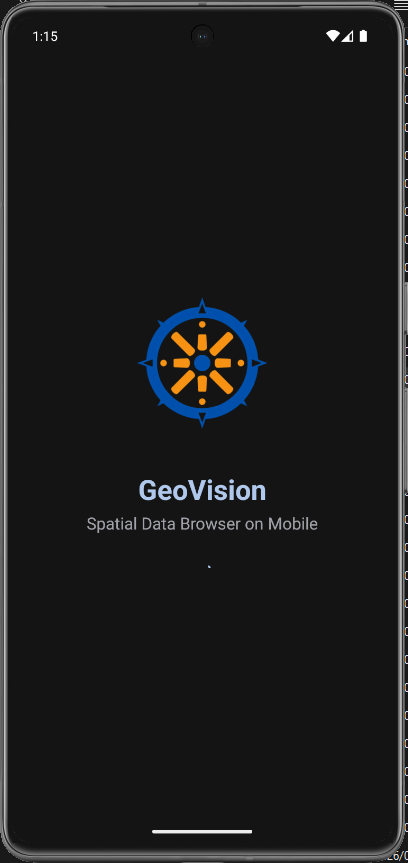
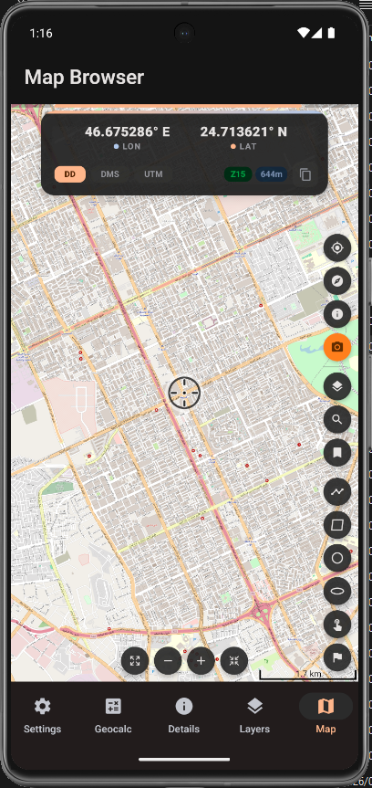
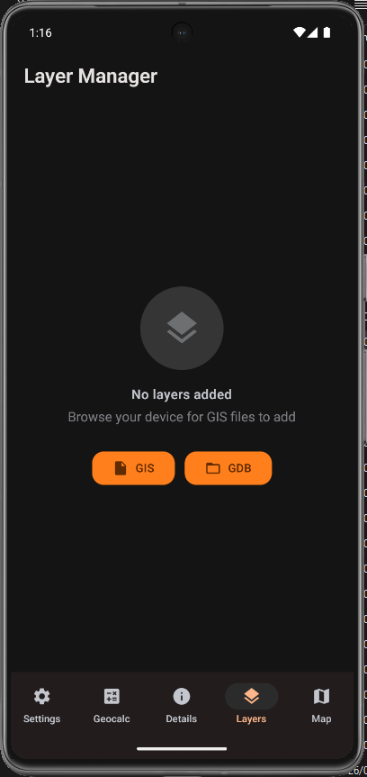
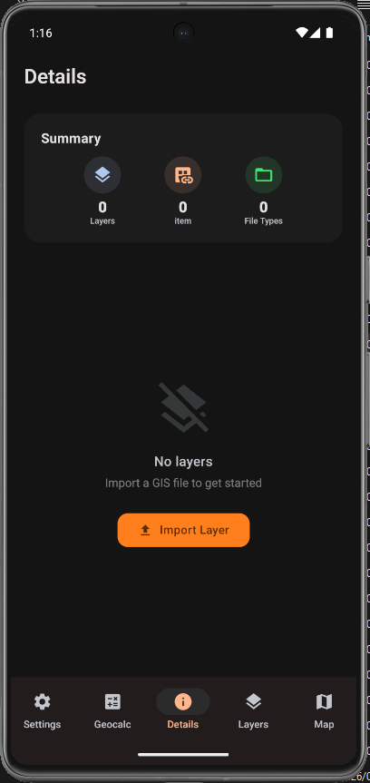
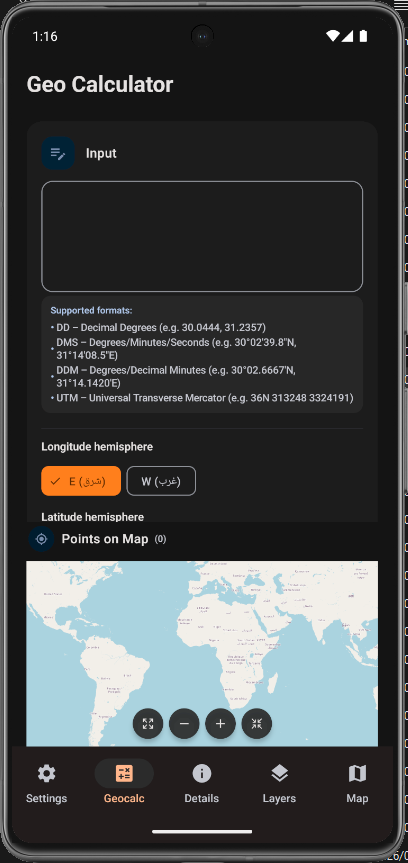
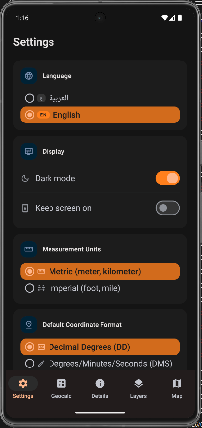

# 🗺️ GeoVision - Mobile GIS Application

<p align="center">
  
  &nbsp;&nbsp;
  
  &nbsp;&nbsp;
  
</p>

<p align="center">
  <b>تطبيق أندرويد متكامل ومفتوح المصدر لنظم المعلومات الجغرافية (GIS) والعمل الميداني</b><br>
  <b>Powerful Open-Source Android GIS & Field Data Exploration Platform</b>
</p>

<p align="center">
  
  
  
  
  
</p>

---

## 📖 نظرة عامة | Overview

**GeoVision** هو تطبيق محمول احترافي لنظم المعلومات الجغرافية (GIS)، مصمم لخدمة المساحين والمهندسين والباحثين في العمل الميداني والمكتبي. يتيح التطبيق استعراض، استيراد، تحليل، وتحرير ملفات البيانات الجغرافية دون الحاجة إلى الاتصال بالإنترنت (Offline-First) وبأداء فائق السرعة.

**GeoVision** is a high-performance Android GIS application built with 100% Kotlin and Jetpack Compose. It allows GIS professionals, surveyors, and field engineers to view, import, query, style, and export local geospatial data completely offline.

---

## 🌟 أبرز المميزات الحديثة | Key Highlights

### 📊 1. معالج جداول إكسيل و CSV الذكي (Excel & Spreadsheet Engine)
- **قارئ تدفقي خفيف وسريع:** دعم ملفات `.xlsx` و `.xls` و `.csv` و `.tsv` بدون مكتبات ضخمة، مع استهلاك فائق الكفاءة للذاكرة.
- **نافذة تعيين الإحداثيات:** اختيار حقول الإحداثيات (X و Y إجباري، Z اختياري)، مع حقل التسمية (Label).
- **ربط كافة الأعمدة تلقائياً:** يتم ربط جميع الأعمدة الأخرى المتبقية في الملف بجدول السمات لكل نقطة لتصفحها بالكامل في جدول البيانات ونافذة الاستعلام.
- **إعادة الإسقاط الفوري:** تحويل الإحداثيات تلقائياً من UTM أو الحزام الأحمر المصري (EPSG:22992) إلى WGS84.

### 📥 2. مركز الاستيراد الموحد (Unified Import Center)
- واجهة مركزية حديثة بنظام البطاقات تتيح الوصول بلمسة واحدة لكافة صيغ الـ GIS المدعومة مع أيقونات ووصف تفصيلي.
- متاح مباشرة من الشريط العلوي لشاشة الطبقات، ومن الزر العائم (+)، وبطاقة الترحيب عند فراغ الطبقات.

### 🗄️ 3. دعم شامل لقواعد بيانات Esri Geodatabase و OGC GeoPackage
- **Esri File Geodatabase (`.gdb`):** قراءة جداول المعالم مباشرة عبر فاحص البايتات التدفقي للطبقات النقطية والخطية والمساحية.
- **Esri Mobile Geodatabase (`.geodatabase`):** دعم كامل لقواعد بيانات ArcGIS Pro SQLite، وقراءة هندسات ST_GEOMETRY و Esri Shape Buffer.
- **OGC GeoPackage (`.gpkg`):** تصفح واختيار الطبقات الفردية أو المجمعة مع الفهارس المكانية R-Tree.

### 🎨 4. تحكم متقدم بخصائص وترميز الطبقات (Symbology & Labeling)
- **ترميز النقاط:** دائرة (Circle)، مربع (Square)، مثلث (Triangle)، معين (Diamond)، إشارة + (Cross)، دبوس (Pin).
- **أنماط الحدود والخطوط:** خط متصل (Solid)، متقطع (Dashed)، منقط (Dotted).
- **ألوان مستقلة:** فصل لون التعبئة (Fill Color) عن لون الحدود (Stroke Color) مع التحكم الكامل بدرجة الشفافية (Opacity).
- **تسميات المعالم على الخريطة (Map Feature Labeling):** إظهار الأسماء فوق المعالم مباشرة من أي حقل سمات يختاره المستخدم، مع تحديد حجم الخط، ولونه، وهالة التباين (Contrast Halo).

### 📤 5. تصدير ومشاركة بيانات الطبقات (Layer Export Center)
- تصدير فوري ومباشر لأي طبقة مع كافة إحداثياتها وسماتها إلى:
  - **GeoJSON** (`.geojson`)
  - **CSV** (`.csv` مع حقول X, Y, Z وجميع السمات)
  - **KML** (`.kml`)
  - **GeoPackage** (`.gpkg`)
- خياران مرنان: **مشاركة فورية** عبر تطبيقات النظام، أو **حفظ كملف** في أي مجلد على الجهاز.

### 🗺️ 6. خرائط وأدوات قياس ميدانية
- خرائط بدون إنترنت وخرائط متصلة (OpenStreetMap, Satellite, Topo, Esri).
- أدوات قياس دقيقة للمسافات والمساحات وحساب الإحداثيات.
- حاسبة جغرافية لتحويل الإحداثيات بين الأنظمة العالمية والمحلية.

---

## 🗂️ الصيغ المدعومة | Supported Formats

| الصيغة / Format | الامتداد / Ext | نوع البيانات / Type | الدعم / Support |
|---|---|---|---|
| **Microsoft Excel** | `.xlsx`, `.xls` | جداول نقطية مع سمات | ✅ كامل مع تعيين X/Y/Z |
| **Comma-Separated** | `.csv`, `.tsv`, `.txt` | جداول نقطية مع سمات | ✅ كامل مع تحويل الإسقاط |
| **Esri Mobile Geodatabase** | `.geodatabase` | طبقات متجهات SQLite | ✅ كامل (ArcGIS Pro) |
| **Esri File Geodatabase** | `.gdb`, `.zip` | قواعد بيانات مكانية | ✅ كامل |
| **OGC GeoPackage** | `.gpkg` | معالم مكانية وفهارس | ✅ كامل (OGC Standard) |
| **ESRI Shapefile** | `.shp`, `.zip` | معالم ونقاط وخطوط ومضلعات | ✅ كامل مع قراءة DBF & PRJ |
| **Google Earth** | `.kml`, `.kmz` | معالم ومسارات وأنماط | ✅ كامل مع استخراج الأرشيف |
| **GeoJSON** | `.geojson`, `.json` | معايير الويب الجغرافي | ✅ كامل (RFC 7946) |
| **GPS Exchange** | `.gpx` | مسارات ونقاط ملاحة | ✅ كامل |
| **Geotagged Photos** | `.jpg`, `.jpeg` | صور مع إحداثيات EXIF GPS | ✅ كامل ومباشر في الذاكرة |

---

## 📱 لقطات من التطبيق | Screenshots

<p align="center">
  
  
</p>

<p align="center">
  
  
</p>

<p align="center">
  
  
</p>

---

## 🛠️ متطلبات التشغيل والتطوير | Requirements

- **نظام التشغيل:** Android 8.0 (API 26) فما فوق.
- **بيئة التطوير:** Android Studio Ladybug / Koala أو أحدث.
- **إصدار جافا:** JDK 17+.
- **أدوات البناء:** Gradle 8.13+ مع Android Gradle Plugin 8.8+.
- **اللغة:** Kotlin 2.0.21+.

---

## 🚀 التثبيت والبناء | Build & Installation

### 1. استنساخ المستودع (Clone)
```bash
git clone https://github.com/ahmadibrahim4geo/GeoVision.git
cd GeoVision
```

### 2. بناء ملف الـ APK عبر Gradle
```bash
# بناء حزمة Core الخفيفة والسريعة
./gradlew assembleCoreDebug

# أو على نظام ويندوز:
.\gradlew.bat assembleCoreDebug
```

ستجد ملف الـ APK الناتج في المسار:
```
app/build/outputs/apk/core/debug/app-core-debug.apk
```

### 3. تشغيل الاختبارات الآلية (Unit Tests)
```bash
.\gradlew.bat testCoreDebugUnitTest
```

---

## 🏛️ البنية المعمارية | Architecture

يتبع التطبيق أحدث ممارسات بنية أندرويد الحديثة (**Modern Android Architecture**):
- **UI Layer:** مبنية بالكامل باستخدام Jetpack Compose بنمط التصميم التفاعلي Declarative UI وتصميم Material 3.
- **State Management:** إدارة الحالة عبر `ViewModel` و `StateFlow` مع دعم كامل لتغيير الاتجاه وحفظ الحالة.
- **Data Layer:** مستودع مركزي `LayerRepository` يفصل بين قراءة الملفات، والتحويل الإسقاطي، والمعالجة التخزينية.
- **Parsers:** قوارئ تدفقية (Streaming Parsers) عالية السرعة لتفادي استهلاك الذاكرة وتجنب أخطاء OutOfMemory.
- **Canvas Rendering:** محرك رسم مخصص `OptimizedCanvasOverlay` يرسم المعالم والأنماط والتسميات مباشرة على طبقة الـ Canvas المسرعة عتادياً.

---

## 📄 الترخيص | License

هذا المشروع مرخص تحت رخصة **MIT** - راجع ملف [LICENSE](LICENSE) لمزيد من التفاصيل.

---

<p align="center">
  صنع بكل ❤️ لخدمة مجتمع نظم المعلومات الجغرافية والمساحة العربي والعالمي
</p>
